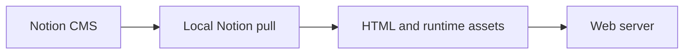

# Rendering in LocalNotion

LocalNotion consumes the MIT-licensed `Sphere10.Framework.Web.VisualRenderer` library from Sphere10 Framework. Workspace builds use `../Framework`; NuGet builds use the same exact clean Framework version for all four Framework packages.

LocalNotion.Core/Rendering owns conversion of Notion objects and repository
metadata into the renderer's visual model. LocalNotion also owns repository
paths, persistence, links, synchronization, and optional HTML post-processing.
The renderer accepts visual objects and returns HTML/text and assets without
access to Notion credentials or repositories.

The public rendering API uses the Sphere10.Framework.Web.VisualRenderer namespace. Refer to
the authorized package's README for standalone usage. See
[theme overrides](renderer-themes.md) for LocalNotion customization.

## HTML source formatting

Complete CMS documents use the existing `CleanHTML` formatting pass, enabled in
`LocalNotion.Core.csproj`, to produce readable HTML including the document head.
Themes with the `suppress_formatting` trait bypass this pass. Ordinary source
resource rendering remains unchanged. Code, Mermaid source, script/style bodies
and meaningful inline spacing must retain their semantics.

## Native Notion tab blocks

LocalNotion supports Notion's native tabbed content blocks in the current source build. Author the tabs and their contents in Notion, then pull the owning page using the normal `localnotion pull --path "./website" --objects PAGE_ID` command. No CMS Tag, special Theme, HTML injection or new CLI command is required. A subsequent `render` uses downloaded content; it does not fetch edits from Notion.

The Notion API represents a tab group as a `tab` block. Its direct paragraph children supply panel labels and optional icons; the children of those paragraphs supply each panel's content. LocalNotion preserves the nested graph and projects it to the independent renderer's `TabsBlock` and `TabBlock` models. Uploaded label icons participate in ordinary attachment localization. Paragraphs outside a tab group retain their existing presentation.

The generated website includes all panel contents as static HTML. Browser JavaScript adds keyboard-accessible tab controls; without JavaScript, all panels remain readable. Links to headings inside hidden panels reveal the containing tabs, including nested tabs. Plain-text output and print styles retain every panel. Tabs provide no privacy boundary and do not reduce the size of a generated page.

The built-in `default` theme supplies the tab templates; CMS inherits them automatically. Tab styling and initialization are comment-separated sections of the existing `ln.css` and `ln.js`, so there are no additional tab CSS/JS requests or a separate tab theme. Online rendering uses those standard default-theme CDN assets; offline rendering emits local assets beneath `render-assets/`, which must be published with the HTML. Existing theme overlays can override `tabs.html` and `tab.html`, but must preserve their runtime and DOM hooks. See the renderer's [tabbed content reference](../../Framework/docs/visual-renderer/tabs.md) in a workspace checkout.

This is a source-build capability as of 12 November 2026. An installed executable or public release must contain this updated client and renderer before it can import native tabs. The vendored SDK integrates upstream main while preserving the existing HTTP-client lifetime and JSON fixes; see [SDK provenance](../Notion.Client/UPSTREAM.md). The standard tab assets have been published to the Sphere10 CDN.

## Mermaid code blocks

### Author in Notion

Insert a native **Code** block and select **Mermaid** from its language menu. Enter the diagram definition directly in the block, without surrounding Markdown fences. An optional caption describes the diagram beneath it.



The language selects diagram rendering. It does not require a new CLI command, a CMS Theme, an HTML block or an `{INJECT}` caption. LocalNotion's native projection maps the language to `CodeLanguage.Mermaid` and preserves its source and caption. See the [CMS guide](cms/index.md#add-mermaid-diagrams) for the authoring workflow.

Use the normal commands, replacing `PAGE_ID` with the owning Notion Page's ID:

```sh
localnotion pull --path "./website" --objects PAGE_ID
localnotion render --path "./website" --objects PAGE_ID
```

`pull` downloads the saved source and renders by default. `render` uses already downloaded content, for example after a theme change; it cannot fetch a recent Notion edit. These commands retain the repository's configured Git commit/push behavior.

### Source controls and errors

The figure contains an SVG display area, an optional caption and hidden encoded source for the runtime. The **Diagram source** disclosure remains commented out in `default/mermaid.html`; uncomment it to restore the optional control. Invalid definitions show an explanatory message while other diagrams continue rendering.

Other Code languages keep their ordinary code presentation. Plain-text output returns Mermaid source rather than an image. Diagram rendering requires browser JavaScript; without it, the diagram remains unrendered and its source stays hidden.

The pinned runtime uses Mermaid's strict security level, disables HTML labels and does not enable executable callbacks or click directives. Diagram-level settings cannot weaken those protections. The source is preserved verbatim, but Mermaid interprets and sanitizes diagram labels: HTML-like text is not a promise of literal label output. Prefer ordinary labels and Mermaid's supported escaping rather than embedded HTML.

### Runtime and hosting

The renderer bundles **Mermaid 11.12.0**, its initializer, stylesheet and license notices. It returns those assets locally in both online and offline mode, even when other website assets use a CDN. No remote diagram service, Node.js installation or server-side JavaScript renderer is required.

LocalNotion writes returned assets beneath the repository's public `render-assets/` directory. Online mode generates hosted URLs; offline mode generates links relative to the rendered document. Publish or move that directory with the HTML, retaining its hashed subdirectories and licenses. Keep source templates, registry objects and credentials in the private `.localnotion` tree; do not expose it to repair asset links. See [asset publication and theme overrides](renderer-themes.md#publishing-the-result).

An extracted `default/code.html` override does not suppress the dedicated `mermaid.html` template. Custom diagram templates must retain their runtime token and DOM hooks; see [Mermaid template overrides](renderer-themes.md#mermaid-template-overrides).

### Availability

Mermaid support is verified in the locally installed development build **LocalNotion 1.7.0.8**, using private renderer package **3.1.3-mermaid-test.20261025.2**, as of **25 October 2026**. The installed command rendered six Mermaid figures and emitted all five runtime files in an isolated repository.

That installation predates the current source-reference build. The public **3.1.3** package does not contain these development features; current builds require the updated renderer source or a separately produced package containing it. See [building](#building) for explicit dependency selection without replacing the ordinary package cache.

This local installation is not a public **1.7.0.8** release. Public renderer, LocalNotion GitHub and Docker releases remain pending separately. Check the selected executable and its release notes before relying on this feature on another machine or in a container.

## Licensing and distribution

Sphere10.Framework.Web.VisualRenderer is MIT-licensed, as declared in its project
and included LICENSE.txt. Third-party components and assets retain their
own terms. Preserve those notices when redistributing the package's output.

LocalNotion remains licensed under the [GNU GPL](../LICENSE). The historical
[COPYING.EXCEPTION](../COPYING.EXCEPTION) remains preserved; it grants permissions
only for the copyrights described in that file and does not replace third-party
licenses. The current renderer's MIT license is independent of that exception.

Keep LocalNotion's LICENSE, COPYRIGHT and COPYING.EXCEPTION with distributions.
The CLI project copies them to build and publish output as separate files,
including when publishing a single executable. The renderer's NuGet package
separately supplies its LICENSE.txt and THIRD-PARTY-NOTICES.md under
licenses/Sphere10.Framework.Web.VisualRenderer/, with dependency notices in its third-party
subfolder. Preserve that directory in installers, containers and archives.
Do not replace the renderer license with LocalNotion's GPL license.

## Building

The renderer belongs to the Framework solution. Set `Sphere10FrameworkRoot` to
select another clean Framework checkout. It uses the same configuration as LocalNotion.

```powershell
dotnet build LocalNotion.sln -c Release -p:BuildNumber=0 -p:BuildRevision=0
```

For package mode, make the matching clean Framework package set available through
a configured NuGet feed, including `Sphere10.Framework.Web.VisualRenderer`:

```powershell
dotnet build LocalNotion.sln -c Release -p:UseSphere10FrameworkSource=false -p:Sphere10FrameworkVersion=<exact-clean-version> -p:BuildNumber=0 -p:BuildRevision=0
```

The renderer shares Framework's version. The former `UseSphere10VisualRendererSource`,
`Sphere10VisualRendererRoot` and `Sphere10VisualRendererVersion` switches have been
replaced by the standard Framework reference configuration. Source and package builds
retain MIT and third-party notices. CMS presets remain owned by LocalNotion.Core;
site-specific themes remain external overlays.

Native CI and Docker use the one immutable `build/framework-source.ref` commit.
That pin must identify a published Framework revision containing the renderer before
a release can succeed. A local build or locally packed NuGet file does not establish
public package availability or update installed executables.

## Web bookmark previews

During pull, `WebBookmarkBuilder` parses destination HTML using HtmlAgilityPack. Open Graph, Twitter Card and HTML fallbacks populate persisted `LocalNotionBookmark` data. Requests are reused only within that pull; the next pull refreshes them. `NotionRenderModelBuilder` maps stored data into `BookmarkBlock`, so render uses no destination requests or cache. See [bookmark rendering and metadata rules](../../Framework/docs/visual-renderer/bookmarks.md).
